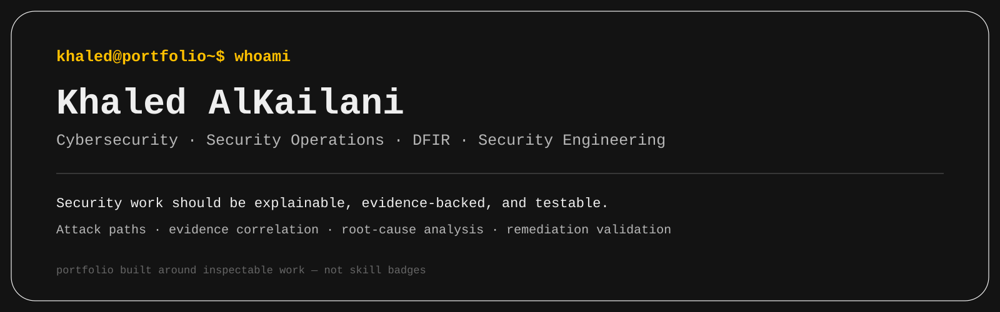

<div align="center">



</div>

---

## Start with the work

This portfolio is built around **inspectable security work**.

Not a long list of tools.  
Not self-rated skill bars.  
Not claims that cannot be checked.

The projects below show how I approach security problems: reconstruct the technical story, separate evidence from assumption, identify the root cause, and verify whether the fix actually changed the outcome.

<div align="center">


</div>

---

# Featured Case Study

## [Attack to Validation](https://github.com/KhaledAlkailani/cybersecurity-capstone-attack-to-validation)

**Offensive Security · DFIR · Linux · Application Security · Remediation Validation**

> **2 servers · 8 findings · 2 connected attack paths · 8 validated remediations**

A two-server security assessment that continued beyond vulnerability discovery.

The offensive phase established how the weaknesses could be reached and chained. The defensive phase then reconstructed the same activity using **service logs, Apache logs, packet evidence, filesystem artifacts, application source, and container metadata**.

Each finding was traced to a root cause, remediated, and retested against the original behavior.

### What can be inspected

| Evidence | What it demonstrates |
|---|---|
| [Attack paths](https://github.com/KhaledAlkailani/cybersecurity-capstone-attack-to-validation/blob/main/docs/attack-paths.md) | How separate weaknesses connected into larger compromise paths |
| [Timeline](https://github.com/KhaledAlkailani/cybersecurity-capstone-attack-to-validation/blob/main/docs/timeline.md) | Reconstruction from timestamps and multiple evidence sources |
| [Root-cause analysis](https://github.com/KhaledAlkailani/cybersecurity-capstone-attack-to-validation/blob/main/docs/root-cause-analysis.md) | Why the findings existed, not only what was vulnerable |
| [Remediation & validation](https://github.com/KhaledAlkailani/cybersecurity-capstone-attack-to-validation/blob/main/docs/remediation-and-validation.md) | Whether the original impact still worked after the fix |
| [Scope & limitations](https://github.com/KhaledAlkailani/cybersecurity-capstone-attack-to-validation/blob/main/docs/scope-and-limitations.md) | Where the evidence stops and where claims should stop too |

**Project:** [Open the repository →](https://github.com/KhaledAlkailani/cybersecurity-capstone-attack-to-validation)

---

# Additional Case Studies

<table>
<tr>
<td width="50%" valign="top">

## [TwoMillion Security Assessment](https://github.com/KhaledAlkailani/TwoMillion-Security-Assessment)

**Web / API Security · Authorization · Command Injection · Linux**

An authorized Hack The Box assessment documenting how multiple weaknesses combined into a larger attack path.

The write-up focuses on the sequence between findings, the security control that failed, and practical remediation rather than treating each vulnerability as an isolated screenshot.

**Signals in the work**
- Web and API testing
- Authorization analysis
- Attack-path reasoning
- Technical finding documentation
- Remediation thinking

</td>
<td width="50%" valign="top">

## [JobApplicant — Windows Forensic Investigation](https://github.com/KhaledAlkailani/J0bApplic-nt)

**DFIR · IIS / Windows Logs · NTFS · Filesystem Analysis · Python**

A forensic investigation into suspicious activity in a Windows environment.

The analysis correlates web, host, and filesystem evidence, then goes deeper into NTFS structures when the relevant evidence is no longer available as a normal file.

**Signals in the work**
- Evidence correlation
- Windows forensic reasoning
- IIS and host-log analysis
- NTFS / MFT investigation
- Working from incomplete evidence

</td>
</tr>
</table>

---

# Working Method

<div align="center">


</div>

The sequence matters.

A finding is useful.  
A defensible explanation of **what happened, why it happened, and whether the remediation held up** is more useful.

---

# Security Principles I Keep Coming Back To

```text
Open port ≠ vulnerability.

Finding ≠ evidence.

Authentication ≠ authorization.

HTTP 200 ≠ exploit success.

Container root ≠ host root.

Deleting an exposed credential ≠ rotating it.

Patch installed ≠ fix proven.
```

These distinctions look small, but they are where weak technical conclusions often begin.

---

# Areas Represented in the Portfolio

| Area | Evidence in the projects |
|---|---|
| **Security Operations** | Log review, correlation, timelines, investigation reasoning |
| **DFIR** | Host artifacts, filesystem evidence, Windows forensics, packet evidence |
| **Security Engineering** | Hardening, access control, credential handling, remediation validation |
| **Offensive Security** | Enumeration, web/API testing, attack-path development, controlled exploitation |
| **Application Security** | XSS, authorization failures, unsafe input handling, exposed configuration and credentials |
| **Technical Communication** | Findings, root causes, limitations, remediation steps, evidence-backed conclusions |

---

# Training

## Nashama Cyber 12

**440 hours of practical cybersecurity training** through Jordan's National Cyber Security Center.

The training covered work across:

`Security Operations` ·
`Networking` ·
`Linux & Windows` ·
`Incident Response` ·
`Log Analysis` ·
`Packet Analysis` ·
`Vulnerability Assessment` ·
`Web Security` ·
`Security Hardening`

---

# Practice Platforms

**TryHackMe:** [VAnTAB](https://tryhackme.com/p/VAnTAB)

**Hack The Box:**  
[TwoMillion Security Assessment](https://github.com/KhaledAlkailani/TwoMillion-Security-Assessment) ·
[JobApplicant Investigation](https://github.com/KhaledAlkailani/J0bApplic-nt)

---

<div align="center">

### Khaled AlKailani

**Cybersecurity · Security Operations · DFIR · Security Engineering**

[GitHub](https://github.com/KhaledAlkailani) · [TryHackMe](https://tryhackme.com/p/VAnTAB)

<br>

<sub>All security assessments referenced here were performed in authorized environments.</sub>

</div>
