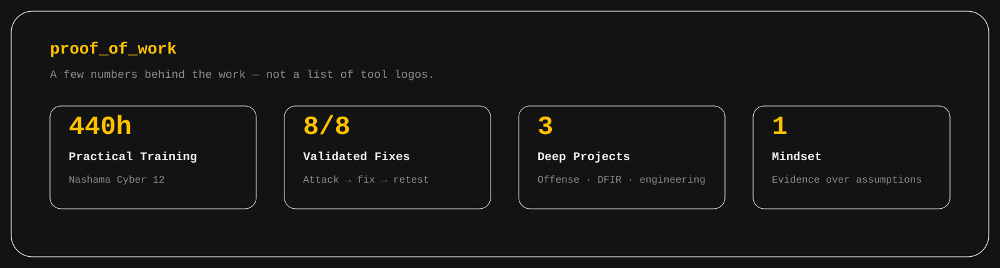
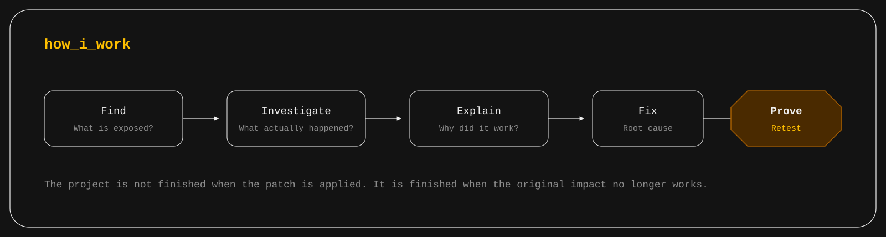

<div align="center">


</div>

---

## If you only have 60 seconds

I am a cybersecurity graduate based in Jordan with **440 hours of practical training through Nashama Cyber 12**, delivered through Jordan's National Cyber Security Center.

The work I want to be judged on is not a list of tools.

It is whether I can take a security problem from **initial observation to evidence, root cause, remediation, and validation**.

That is the pattern behind the projects below.

<div align="center">



</div>

---

## Why hire me?

<table>
<tr>
<td width="33%" valign="top">

### 01 · Investigation mindset

I like answering the question behind the alert:

**What actually happened?**

I work across logs, network traffic, application behavior, filesystem artifacts, and configuration evidence rather than relying on a single signal.

</td>
<td width="33%" valign="top">

### 02 · I understand both sides

I have worked through offensive attack paths and then investigated the same activity from the defender's side.

That helps me think beyond *"there is a vulnerability"* and ask how it can be reached, detected, fixed, and verified.

</td>
<td width="33%" valign="top">

### 03 · I validate the fix

A remediation is not complete to me because a setting changed or a patch installed.

I prefer to repeat the original behavior and show that the previous security impact can no longer be reproduced.

</td>
</tr>
</table>

<div align="center">



</div>

---

# Selected Work

These are the projects I would want a technical interviewer or hiring manager to open first.

## 01 · [Attack to Validation](https://github.com/KhaledAlkailani/cybersecurity-capstone-attack-to-validation)

**Offensive Security · DFIR · Incident Reconstruction · Linux · Remediation Validation**

> **2 servers · 8 findings · 2 attack paths · 8 validated remediations**

A full security assessment across two Linux servers.

The project started with offensive testing, but the stronger part came afterward: reconstructing the activity from service logs, Apache logs, packet evidence, application artifacts, source code, and filesystem evidence.

The findings were traced to their root causes, remediated, and the original attack behavior was repeated to verify the fixes.

**Why it matters**

- Shows how separate weaknesses can connect into complete attack paths.
- Demonstrates evidence correlation instead of relying only on a pentest report.
- Includes root-cause analysis, MITRE ATT&CK/D3FEND mapping, remediation, and validation.
- Documents limitations clearly — including the difference between container root and host root, and authentication versus authorization.

**Start here:** [Project README](https://github.com/KhaledAlkailani/cybersecurity-capstone-attack-to-validation) · [Attack Paths](https://github.com/KhaledAlkailani/cybersecurity-capstone-attack-to-validation/blob/main/docs/attack-paths.md) · [Validation](https://github.com/KhaledAlkailani/cybersecurity-capstone-attack-to-validation/blob/main/docs/remediation-and-validation.md)

---

## 02 · [TwoMillion Security Assessment](https://github.com/KhaledAlkailani/TwoMillion-Security-Assessment)

**Web & API Security · Access Control · Command Injection · Linux**

An authorized Hack The Box assessment documenting how multiple application and system weaknesses combined into a larger compromise path.

The write-up focuses on more than exploitation: it explains **why each weakness mattered to the next step**, what the underlying security failure was, and how the issue should be remediated.

**What this demonstrates**

- Web and API security testing
- Authorization analysis
- Attack-path thinking
- Technical finding documentation
- Practical remediation reasoning

---

## 03 · [JobApplicant — Windows Forensic Investigation](https://github.com/KhaledAlkailani/J0bApplic-nt)

**DFIR · Windows / IIS Evidence · NTFS · Filesystem Analysis · Python**

A forensic investigation into suspicious activity in a Windows environment.

The investigation correlates web, Windows, and filesystem artifacts and goes deeper into NTFS structures when evidence is no longer available as a normal file.

The public write-up focuses on the investigative process rather than publishing challenge answers.

**What this demonstrates**

- Evidence correlation
- Windows forensic reasoning
- IIS and host-log analysis
- NTFS / MFT investigation
- Working from artifacts when the obvious evidence is gone

---

# What I Bring

I am building toward roles where security work requires both technical depth and clear judgment.

| Area | What I can demonstrate |
|---|---|
| **Security Operations** | Log analysis, event correlation, investigation thinking, separating an alert from actual evidence |
| **DFIR / Incident Investigation** | Timelines, artifacts, packet evidence, filesystem evidence, source correlation |
| **Security Engineering** | Hardening, remediation reasoning, access control, credential handling, validation |
| **Offensive Security** | Enumeration, web/API testing, attack-path development, controlled exploitation |
| **Application Security** | XSS, authorization failures, unsafe input handling, credential and configuration exposure |
| **Communication** | Findings, root causes, limitations, remediation steps, and evidence written so another person can verify the claim |

---

# How I Think About Security

A few principles show up repeatedly in my work:

```text
An open port is attack surface — not automatically a vulnerability.

A finding tells me there is a problem.
Evidence tells me what actually happened.

Authentication answers who you are.
Authorization answers what you are allowed to do.

HTTP 200 does not automatically mean exploit success.

Root inside a container does not automatically mean root on the host.

Removing an exposed credential is not enough.
The credential must also be rotated.

A patch is not proof.
Retesting is proof.
```

Those distinctions matter because good security work depends on making claims the evidence can actually support.

---

# Practice & Continuous Learning

**TryHackMe:** [VAnTAB](https://tryhackme.com/p/VAnTAB)

**Hack The Box work:**
[TwoMillion Security Assessment](https://github.com/KhaledAlkailani/TwoMillion-Security-Assessment) ·
[JobApplicant Investigation](https://github.com/KhaledAlkailani/J0bApplic-nt)

My focus is to keep turning study into work that can be inspected: investigations, write-ups, security tooling, and reproducible technical projects.

---

# Training

### Nashama Cyber 12

**440 hours of practical cybersecurity training** through Jordan's National Cyber Security Center.

Areas I have worked across include:

`Security Operations` ·
`Networking` ·
`Linux & Windows` ·
`Incident Response` ·
`Log Analysis` ·
`Packet Analysis` ·
`Vulnerability Assessment` ·
`Web Security` ·
`Security Hardening`

---

# What I Am Looking For

I am interested in opportunities where I can keep developing through real operational security work, particularly:

- SOC / Security Operations
- Cybersecurity Engineering
- Incident Response / DFIR
- Security Assessment and Vulnerability Management

I am comfortable being the person who has to dig into the details, document what the evidence supports, and keep going until the technical story makes sense.

---

<div align="center">

### Khaled AlKailani

**Cybersecurity · Security Operations · DFIR · Security Engineering**

Jordan

[GitHub](https://github.com/KhaledAlkailani) · [TryHackMe](https://tryhackme.com/p/VAnTAB)

<br>

<sub>All assessments and security testing referenced here were performed in authorized environments.</sub>

</div>
